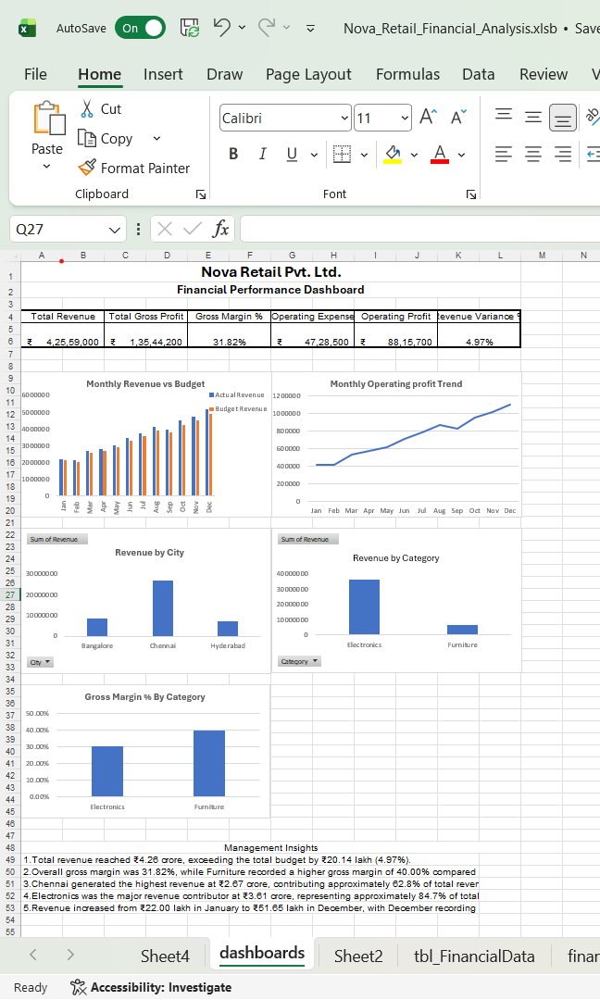

Nova Retail Financial Performance Analysis

Project Overview

This project analyzes the financial performance of a retail business using Microsoft Excel. It includes financial calculations, KPI summaries, Pivot Tables, charts, and an interactive dashboard to support business decision-making.

Tools Used

Microsoft Excel

Excel Formulas

Pivot Tables

Charts and Dashboard

Key Financial Metrics

Metric

Value

Total Revenue

₹4,25,59,000

Total Gross Profit

₹1,35,44,200

Gross Margin

31.82%

Total Operating Expenses

₹47,28,500

Total Operating Profit

₹88,15,700

Revenue Variance

₹20,14,000

Revenue Variance %

4.97%

Key Business Insights

Regional Performance: Chennai generated the highest revenue at ₹2,67,33,000, making it the largest revenue contributor among the three regions.

Product Performance: Electronics generated the highest revenue at ₹3,60,69,000.

Gross Margin Analysis: Furniture achieved a 40% gross margin, compared with 30.35% for Electronics.

Profitability: The business generated an operating profit of ₹88,15,700.

Business Recommendation: Review the factors driving Furniture's higher gross margin and explore opportunities to improve Electronics profitability.

Revenue by Region

Chennai: ₹2,67,33,000

Bangalore: ₹85,75,000

Hyderabad: ₹72,51,000

Dashboard Preview

Project Files

Nova_Retail_Financial_Analysis.xlsx – Excel financial analysis

Nova_Retail_Financial_Analysis.xlsb – Original Excel workbook

Conclusion

This project demonstrates practical skills in financial analysis, KPI reporting, Excel dashboards, profitability analysis, and business decision support.
